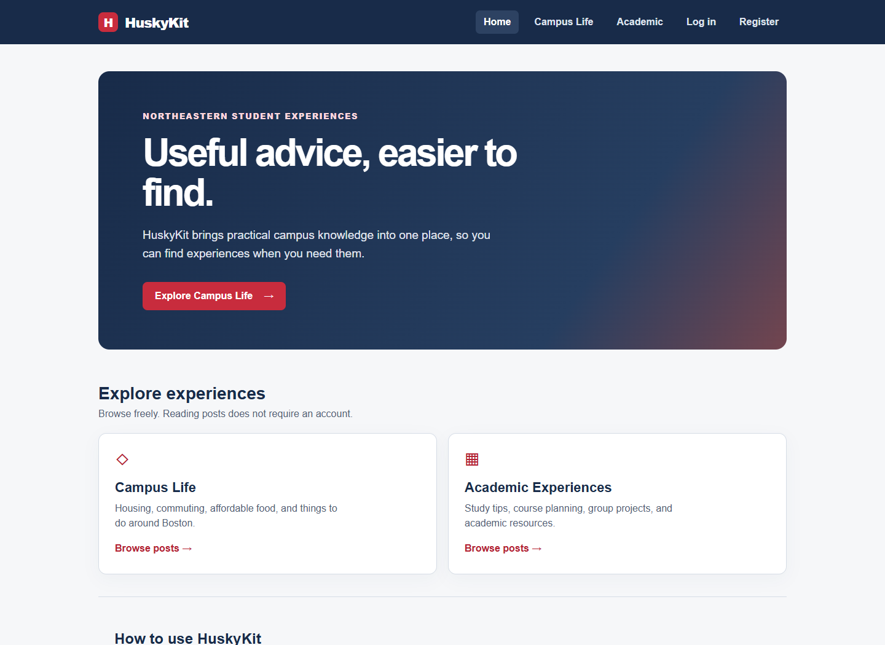

# HuskyKit

HuskyKit is a community website where Northeastern students can share academic and campus life experiences. Visitors can browse and search posts; registered users can create posts and manage their own posts.

## Authors

- Chunzhang Liu — Academic Experiences and shared authentication
- Ziyong Liu — Campus Life Experiences and shared navigation/home page

## Project status

The Academic Experiences and Campus Life Experiences sections each have their own MongoDB collection, Express CRUD API, and React pages. Passport sessions protect writes and the backend enforces post ownership. The Atlas database contains 1,000 clearly marked synthetic posts in each section. Public deployment and final submission checks are still pending.

## Project objective

HuskyKit makes advice about courses, studying, housing, commuting, food, and local activities easier to find than in a group chat. Readers can search and filter either section without an account. Students can register, publish their own experiences, and edit or delete only their own posts.

## Screenshot



Additional local screenshots are in [docs/screenshots](docs/screenshots). The [Academic design](docs/academic-design.md) and [Campus Life design](docs/campus-design.md) include user stories and mockups.

## Class link

[CS 5610 Web Development (Online), Fall 2026](https://www.johnalexis.com/classes/webDevelopment_online_fall_2026/)

## Stack

- Frontend: React with Hooks, React Router, Fetch API, PropTypes
- Backend: Node.js and Express
- Database: MongoDB with the native Node.js driver
- Authentication: Passport local strategy, express-session, bcryptjs

## Structure

- `frontend/`: React client, page and component styles, and Vite configuration
- `backend/`: Express API, database access, authentication, and seed scripts
- `docs/`: design documents, mockups, and local application screenshots

## Build and run locally

Use Node.js 22.13 or newer, npm, and a MongoDB database. Copy `backend/.env.example` to `backend/.env` and set `MONGODB_URI`, `MONGODB_DB`, and a random `SESSION_SECRET` of at least 32 characters. Keep `backend/.env` out of Git. Separate `MONGODB_USERNAME` and `MONGODB_PASSWORD` variables are not used by the app; credentials belong in the MongoDB connection URI.

From the repository root:

```sh
npm ci --prefix backend
npm ci --prefix frontend
npm run seed:academic --prefix backend
npm run seed:campus --prefix backend
npm run build --prefix frontend
npm start --prefix backend
```

The seed scripts are additive and safe to run again. Open `http://localhost:3000` for the built frontend. For development, run `npm run dev --prefix frontend` in a second terminal and open `http://localhost:5173`; Vite proxies API requests to the backend on port 3000.

Run `npm test --prefix backend`, `npm run lint --prefix backend`, `npm run lint --prefix frontend`, and `npm run build --prefix frontend` for the main checks. See [development notes](docs/development.md) for the isolated MongoDB integration tests and deployment details.

## Deployment preparation

The backend serves the built React app from the same origin as its API. A Node web service can build from the repository root with:

```sh
npm ci --prefix backend && npm ci --prefix frontend && npm run build --prefix frontend
```

Start it with `npm start --prefix backend`. Set `MONGODB_URI`, `MONGODB_DB`, `SESSION_SECRET`, and `NODE_ENV=production` in the host's secret environment settings. The public URL will be added after deployment and a live smoke test.

## AI disclosure

AI assistance was used for the initial repository structure and documentation, Campus Life read API, synthetic seed script, React browse/detail pages, design draft, mockups, and related tests. Further AI assistance will be disclosed here as the project develops.

## License

MIT — see [LICENSE](LICENSE).
